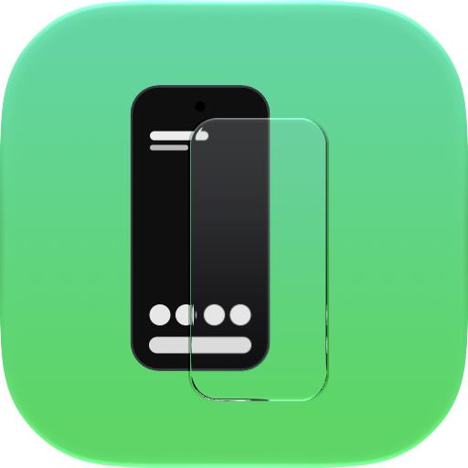
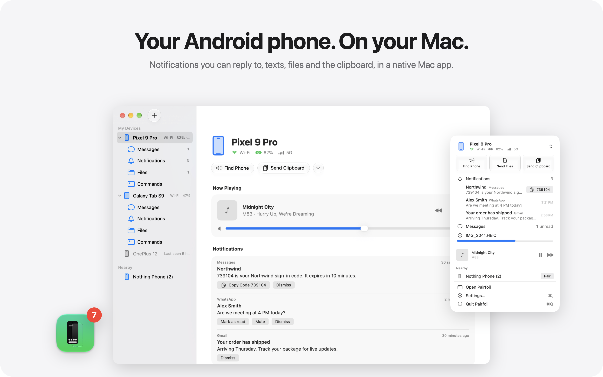
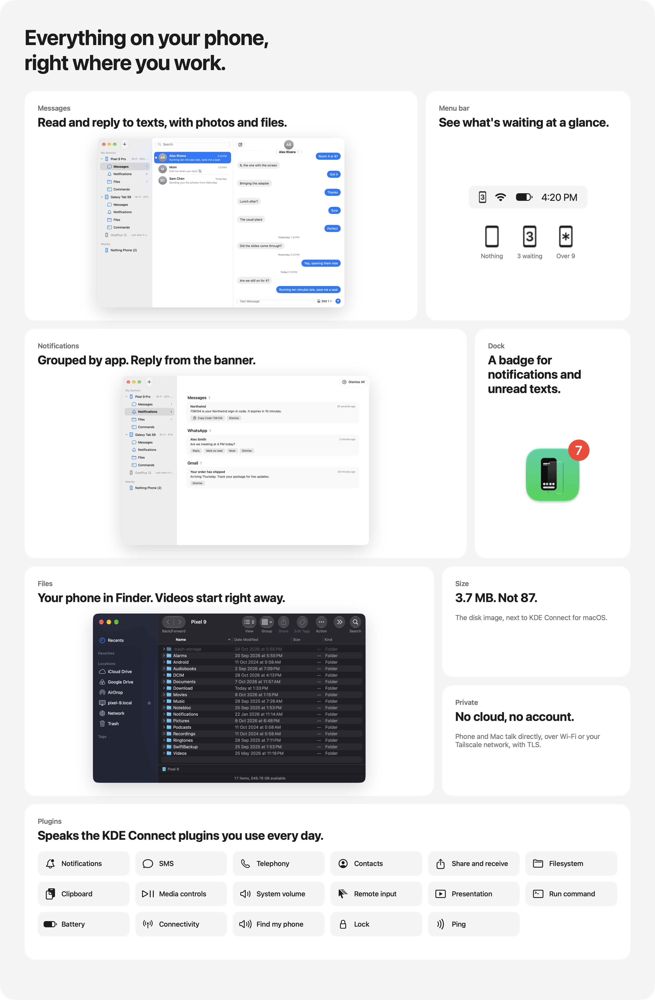

<p align="center">
  
</p>

<h1 align="center">Pairfoil</h1>

<p align="center">
  <strong>Use your Android phone with your Mac.</strong><br />
  Notifications, texts, files and the clipboard, in a small native Mac app.
</p>

<p align="center">
  <a href="https://github.com/harshmandan/pairfoil/releases/latest"></a>
  
  
</p>

<p align="center">
  Based on <a href="https://github.com/subhashhhhhh/Tether"><strong>Tether</strong></a> by <a href="https://github.com/subhashhhhhh">Subhash</a>.
</p>

<p align="center">
  
</p>

Pairfoil is a native macOS app for **KDE Connect**, the free Android app. Pair your phone once, and it shows in the menu bar whenever it's near your Mac. It's written in Swift and SwiftUI, with no Qt, Electron or third-party libraries.

## Why this fork

Pairfoil is a fork of [Tether](https://github.com/subhashhhhhh/Tether) by [Subhash](https://github.com/subhashhhhhh). Tether did the hard part: a native KDE Connect client for the Mac. Thank you, Subhash.

Pairfoil started as bug fixes for Tether and grew into a redesign. That's more than a project can review at once, so it lives here for now. The changes are offered back to Tether as [pull requests](https://github.com/subhashhhhhh/Tether/pulls).

| Area | What Pairfoil changes |
| --- | --- |
| Design | A sidebar with each phone's sections, notifications grouped by app, a menu bar icon with a count |
| Connection | Reconnects sooner after a drop or sleep. Works over IPv6 as well as IPv4 |
| Messages | Texts load in the background, show photos and files, and stay separate for each phone |
| Files | Modern TLS for transfers, files of unknown size, cancelling, and quarantine for received files |
| Permissions | One page shows what macOS allows, with the button that turns it on |
| Reliability | Fixes for crashes, a freeze, and drives left mounted after a force quit |

## Features

<p align="center">
  
</p>

## Install

1. Download the disk image for your Mac from the **[Releases page](https://github.com/harshmandan/pairfoil/releases/latest)**: `AppleSilicon` for M1 and later, `Intel` otherwise. Pairfoil needs **macOS 15** or later.
2. Move **Pairfoil** into **Applications** and open it.
3. On your phone, install **KDE Connect** from [Google Play](https://play.google.com/store/apps/details?id=org.kde.kdeconnect_tp) or [F-Droid](https://f-droid.org/packages/org.kde.kdeconnect_tp/), select your Mac, and click **Pair** on the Mac.

Pairfoil isn't notarized, because that needs a paid Apple developer account. The first time, macOS blocks it: open **System Settings › Privacy & Security** and click **Open Anyway**, or run `xattr -cr /Applications/Pairfoil.app`.

Pairfoil updates itself, and every update must carry the same signature as the app you have ([docs/signing.md](docs/signing.md)). To use it away from your Wi-Fi, turn on **Settings › General › Tailscale**.

## Build from source

You need **Xcode 26** or later. There are no package dependencies.

```bash
git clone https://github.com/harshmandan/pairfoil.git
cd pairfoil
xcodebuild test -project Pairfoil.xcodeproj -scheme Pairfoil -destination "platform=macOS"
```

`scripts/release.sh` builds the signed disk images; see [docs/signing.md](docs/signing.md).

## License

GPL-2.0, as Tether and KDE Connect are. See [LICENSE](LICENSE). Pairfoil is based on [Tether](https://github.com/subhashhhhhh/Tether) by Subhash, and includes [mediaremote-adapter](https://github.com/ungive/mediaremote-adapter) by Jonas van den Berg (BSD-3-Clause). Pairfoil is an independent project and isn't part of KDE.
